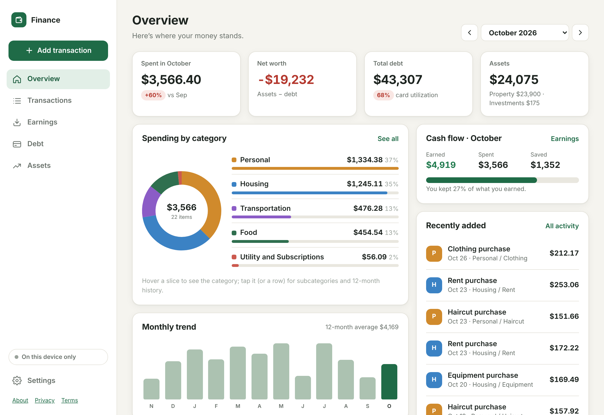
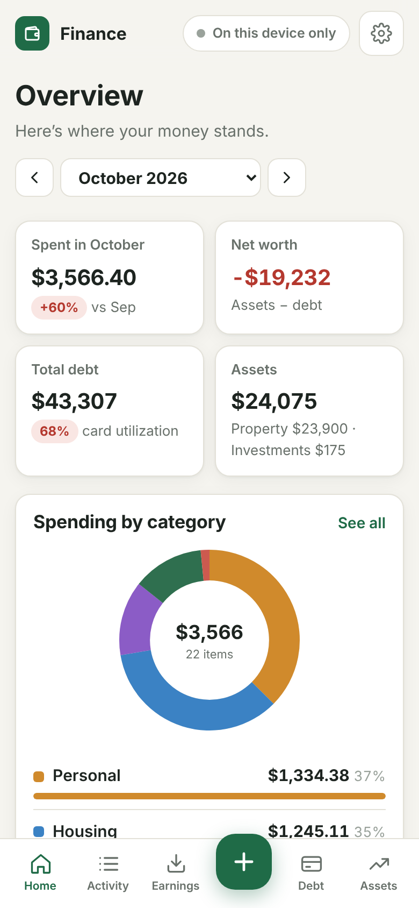
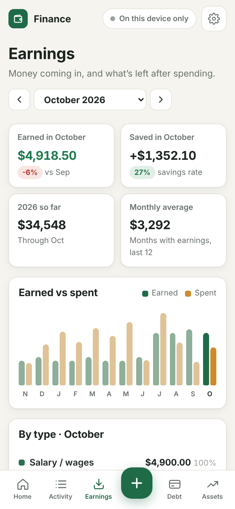
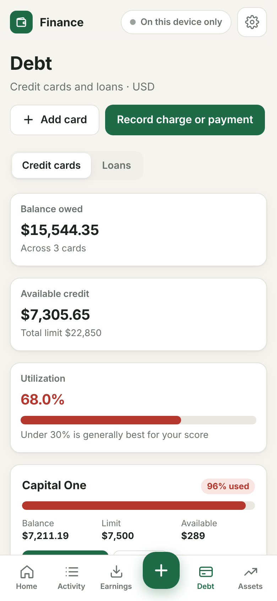
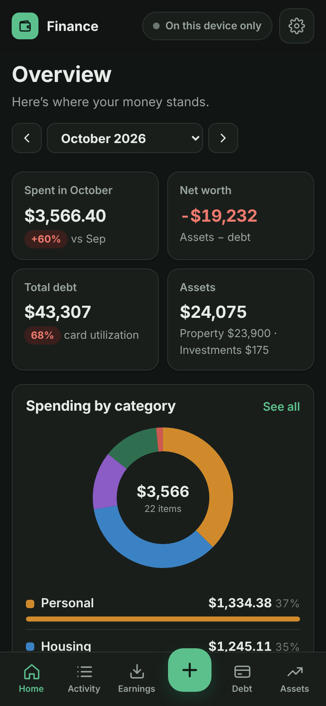

<div align="center">


# Finance

**Your money, at a glance. Private by design.**

A free, open-source personal finance app with **no server**.<br>
Your data stays on your device and, if you choose, in a private folder in **your own Google Drive**.

[](https://rispace.github.io/my-finance/)

[](https://github.com/rispace/my-finance/actions/workflows/tests.yml)
[](https://github.com/rispace/my-finance/actions/workflows/pages/pages-build-deployment)
[](LICENSE)
[](#-install)
[](#-privacy--data)
[](#-how-it-works)
[](#-for-developers)
[](https://github.com/rispace/my-finance/commits/main)

[About](https://rispace.github.io/my-finance/about.html) ·
[Privacy policy](https://rispace.github.io/my-finance/privacy.html) ·
[Terms](https://rispace.github.io/my-finance/terms.html) ·
[Report a problem](https://github.com/rispace/my-finance/issues)

<br>



<br><br>

&nbsp;
&nbsp;
&nbsp;


<sub>Screenshots use made-up demo data.</sub>

</div>

---

## ✨ Features

| | |
|---|---|
| 🧾 **Spending** | Categories and subcategories, a monthly donut chart (tap for subcategories and 12-month history), a 12-month trend, search, filters, four sort orders, CSV import/export |
| 💵 **Earnings** | Paychecks, side income, interest and refunds; monthly totals, savings rate, year-to-date, a 12-month earned-vs-spent chart, filters, sorting and CSV |
| 🎯 **Budgets** | An overall monthly limit plus lines you name yourself ("Groceries", "Netflix, YouTube"), matched automatically to your spending; pace marker; copy last month |
| 💳 **Credit cards** | Balances, limits, utilization, charges, payments and refunds, limit-change history, monthly summary, CSV |
| 🚗 **Loans** | Car, mortgage, student and personal loans; each payment is split into interest (estimated from balance × APR × days) and principal |
| 🏠 **Assets & net worth** | Car, home and savings with value history and equity against linked loans; stocks and ETFs with live prices; uninvested cash |
| 🔄 **Sync** | Optional: keeps your phone, tablet and computer in sync through *your* Google Drive |
| 📴 **Offline** | Opens instantly and works with no connection; changes sync when you're back online |
| 🌗 **Light & dark** | Follows your device's appearance |

## 📲 Install

Finance is a web app you add to your home screen. It then opens full-screen like any other app. There's no app store and nothing to download.

<table>
<tr><th>📱 iPhone / iPad</th><th>🤖 Android</th></tr>
<tr><td>

1. Open **[rispace.github.io/my-finance](https://rispace.github.io/my-finance/)** in **Safari**
2. Tap **Share** 
3. Tap **Add to Home Screen → Add**
4. Open **Finance** from your home screen

</td><td>

1. Open **[rispace.github.io/my-finance](https://rispace.github.io/my-finance/)** in **Chrome**
2. Tap **Install app** (or **⋮ → Add to Home screen**)
3. Open **Finance** from your home screen

</td></tr>
<tr><th>💻 Mac</th><th>🖥️ Windows / Linux</th></tr>
<tr><td>

- **Safari:** open the app, then **File → Add to Dock**
- **Chrome / Edge:** click the install icon at the right of the address bar

</td><td>

- **Chrome / Edge:** click the install icon in the address bar, or **menu → Install Finance**

</td></tr>
</table>

**Then, in the app:**

1. Tap **Start with starter categories**. You can rename or delete them any time.
2. *(Optional)* **Settings → Sign in with Google** on each device to sync them.
3. *(Optional)* Paste a free [Finnhub](https://finnhub.io/register) key in **Settings → Stock prices** to get live stock prices.

> **Tip:** use the installed app rather than a browser tab. Browsers may clear data from websites you haven't visited in a while, but not from installed apps. Signing in to Google adds a second copy, and **Settings → Full backup** gives you a file you control.

## 🔒 Privacy & data

- **There is no Finance server.** The app is static files on GitHub Pages, and nothing you enter is ever sent to the developer.
- **On your device:** all data is stored in the browser's private storage (IndexedDB).
- **In your Google Drive (optional):** signing in grants one permission, `drive.appdata`. It lets the app keep *its own* file in a hidden app folder in your Drive. It **can't see any of your other files**, and nobody else can read that folder.
- **No ads, analytics, trackers or cookies.**
- **Delete anytime:** Settings → Erase this device. In Google Drive, go to **Settings → Manage apps → Finance → Delete hidden app data**. To revoke access, use [myaccount.google.com/permissions](https://myaccount.google.com/permissions).

Full details are in the [privacy policy](https://rispace.github.io/my-finance/privacy.html). Finance's use of information received from Google APIs adheres to the [Google API Services User Data Policy](https://developers.google.com/terms/api-services-user-data-policy), including the Limited Use requirements.

## ⚙️ How it works

```
 Your phone / laptop                                  Your Google Drive
┌──────────────────────────────────┐   1-hour pass    ┌────────────────────────┐
│  App ─▶ IndexedDB (all your data)│ ◀─────────────▶ │ hidden app folder/     │
│          ▲ instant, works offline│ merge by record │   finance-data.json    │
└──────────────────────────────────┘                 └────────────────────────┘
```

- Every record has an id, a last-changed time and a deleted flag. A sync merges your device's copy with the Drive copy **record by record**, and the newest edit wins.
- Syncs run when the app opens, about 2 seconds after each change, when you return to the app, and when the connection comes back.
- Google sign-in renews silently while you're signed in to Google. You see **Tap to sync** only when it can't.

## 🧑‍💻 For developers

No build step and no dependencies: the files in this repo *are* the app.

```bash
git clone https://github.com/rispace/my-finance.git && cd my-finance
python3 -m http.server 8080          # then open http://localhost:8080
node tests/merge.test.mjs && node tests/calc.test.mjs && node tests/earnings.test.mjs
```

<details>
<summary><b>Project structure</b></summary>

| Path | What it does |
|---|---|
| `index.html`, `styles.css` | App shell and design system (light and dark) |
| `about.html`, `privacy.html`, `terms.html` | Public homepage, privacy policy, terms |
| `config.js` | Google OAuth client ID (public; there's no secret) |
| `js/app.js` | Start-up, hash routes, sync scheduling, status chip |
| `js/calc.js` | All money math: dashboard, budgets, cards, loans, portfolio, earnings |
| `js/store.js`, `js/db.js` | In-memory data and on-device storage (IndexedDB) |
| `js/sync.js`, `js/merge.js`, `js/drive.js`, `js/auth.js` | Google Drive sync and sign-in |
| `js/importer.js`, `js/csv.js`, `js/quotes.js` | Backup and CSV import/export, Finnhub prices |
| `js/views/*.js` | Screens: overview, activity, earnings, budget, debt, assets, settings |
| `sw.js`, `manifest.webmanifest` | Offline support and installability |
| `tests/` | Unit tests with a synthetic backup (no real data) |

</details>

<details>
<summary><b>Releasing a change</b></summary>

1. Make the change and test locally.
2. **Bump `CACHE` in `sw.js`** (for example `finance-drive-v4`). Installed apps only pick up new files when it changes.
3. Run `git add -A && git commit -m "…" && git push`. GitHub Pages redeploys in about a minute, and open apps switch to the new version automatically.

</details>

<details>
<summary><b>Run your own copy</b></summary>

Fork the repo and enable GitHub Pages (Settings → Pages → Deploy from branch → `main` / root). Then create your own Google OAuth client:

1. In [Google Cloud Console](https://console.cloud.google.com/), create a project and enable the **Google Drive API**.
2. Go to **Google Auth Platform → Get started**. Choose **External** and fill in the app name and emails.
3. Under **Data Access**, add the scope `https://www.googleapis.com/auth/drive.appdata`.
4. Under **Clients → Create client → Web application**, set the JavaScript origin to `https://<you>.github.io` and the redirect URI to `https://<you>.github.io/<repo>/`.
5. Put the client ID in `config.js`.

[docs/GOOGLE_SETUP.md](docs/GOOGLE_SETUP.md) covers publishing and brand verification.

</details>

<details>
<summary><b>Coming from the older Django "Personal Finance" app?</b></summary>

In the old app, go to **Settings → Full backup → Download**. In Finance, go to **Settings → Import backup (JSON)**. Transactions, categories, payment methods, cards, card activity, limit history, loans, payments, stocks and cash all come across. Importing twice doesn't create duplicates. Budgets and assets weren't part of the old backup, so set those up once.

</details>

## 📄 License

[MIT](LICENSE) © 2026 Mohammad Rafiqul Islam

<sub>Figures in the app come from what you enter and from third-party price data. They aren't financial advice.</sub>
